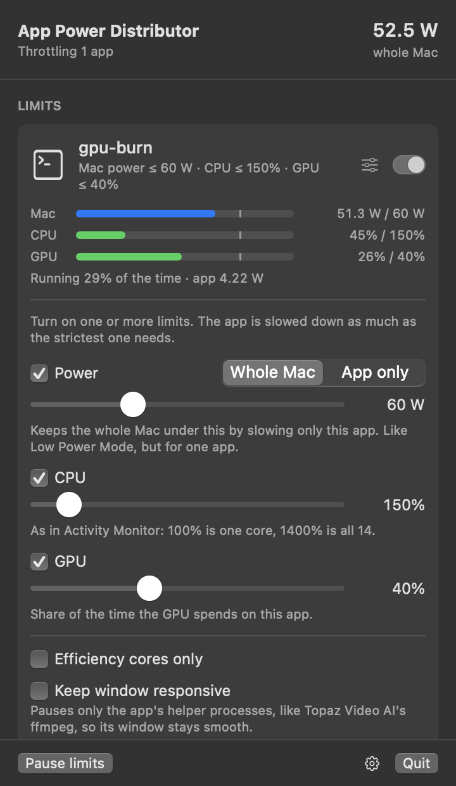

# App Power Distributor

Cap how much power, CPU or GPU **one app** may use on an Apple Silicon Mac, without
slowing down everything else.

The motivating case: Topaz Video AI pins the GPU and most CPU cores while upscaling, the
Mac climbs past 130 W, and the fans roar. Low Power Mode tames it (about 60 W), but it
slows *every* app. App Power Distributor slows down only the app you pick, and only
as much as it takes to stay under your limit.

<p align="center"></p>

## Limits

Turn on any combination of these. The app is slowed down as much as the strictest
one needs, and each gets its own live gauge.

| Limit | Means |
|---|---|
| **Power: whole Mac** (W) | Keep the *whole Mac* under N watts by throttling only this app: Low Power Mode, but for one app. Reads the Mac's power sensor (SMC `PSTR`). |
| **Power: app only** (W) | The app's own CPU + GPU + Neural Engine energy, as the kernel accounts it. Memory, fans and the display come on top (see below). |
| **CPU** (%) | As in Activity Monitor: 100% = one core; 1400% = all 14 cores of an M3 Max. Helpers count toward the app. |
| **GPU** (%) | Share of the time the GPU spends on this app. |
| **Efficiency cores only** | Moves the app onto the E-cores (also lowers its disk and network priority). Combines with any limit, or use it alone to slow an app down gently. |
| **Keep window responsive** | Never pauses the app's main process, only its helpers. Useful when the heavy work runs in helper processes, like Topaz Video AI's `ffmpeg`; if the main process does the work, the limit can't be reached (the app says so). |

Limits live in the menu bar app and apply whenever the app runs, including apps that
aren't open yet. Everything works as a normal user: no root, no kernel extension.

### Why an app's watts are less than the Mac's

While Topaz Video AI upscaled a 4K video, its own CPU, GPU and Neural Engine
power came to about 42 W (GPU 34 W, Neural Engine 5.5 W, CPU 3.3 W), but the Mac drew 125 W from
its charger. The difference is memory, the chip's fabric, the display and fans, which
work harder because of the app, but which macOS doesn't bill to any app. So
**App only** power will always read well below what the whole Mac draws. To cap
what the Mac actually draws, use **Whole Mac**; to cap how hard the app drives the
chip, use **CPU** and **GPU**, which match Activity Monitor and the GPU's own counters.

## How it works

**Measuring.** XNU groups each app with every helper it launches into a *resource
coalition*, and keeps cumulative CPU, GPU and Neural Engine energy (nanojoules) for
it. These counters are readable without root
(`coalition_info_resource_usage`), so "how many watts is Topaz using" is exact, helpers
included. Whole-Mac power comes from the SMC's `PSTR` key.

**Enforcing.** macOS has no per-app power or GPU limit, so the app is *duty-cycled*:
every 100 ms it gets `SIGCONT`, runs for a share of the period, then gets `SIGSTOP`.
A stopped process can't run CPU code or submit new GPU or Neural Engine work, so this
caps all three. On this Mac, duty-cycling a pure GPU load to 50% / 25% / 10% cut its
GPU power from 22 W to 16 / 10.5 / 4.4 W.

**Cycle length.** GPU work an app has already queued keeps running while it's
paused. A GPU-bound app queues more in a few milliseconds of run time than the GPU
finishes in the rest of a 100 ms cycle: Topaz Video AI kept the GPU 100% busy
while running only 7% of every 100 ms, and swung between 15% and 95% below that.
So once an app keeps the GPU at least half busy, it's paused in 1-second cycles
instead, which lets the queue drain during each pause. The same 50% GPU limit then
held at a 50% mean, most seconds within ±5. CPU-bound apps keep 100 ms cycles, so
they stutter less.

**Controlling.** Once a second, each limit's reading is divided by its cap, and the
run share is multiplied by `1 / (the largest of those)`, damped. It's fast going
down, so fans calm quickly, and slower going up, because CPU/GPU clocks and the
power sensor react with a lag. It's an integral controller, so it settles on the
limit even though power isn't proportional to run time (fewer busy cores clock
higher).

**Never leaving an app frozen.** Quitting, Ctrl-C, `kill` and logout all resume
everything. For crashes and `kill -9`, every paused or E-core'd pid is recorded in a
ledger file, and a tiny guardian process (the same binary, started with
`--apd-guardian`) waits for the limiter to exit, then resumes whatever is in the
ledger. As a last resort, `apd resume <app>` un-pauses an app by hand.

### Measured on an M3 Max (macOS 27)

Topaz Video AI upscaling a 4K video (about 42 W of app power, Mac at 125 W), with
**Keep window responsive** on:

| Limit | Reaches it in | Then holds | Mac power |
|---|---|---|---|
| GPU ≤ 50% | ~5 s | 50% mean, most seconds within ±5 (running 14% of the time) | 125 W → about 65 W (54–81) |

Bundled test loads (`power-burn`, included):

| Load | Limit | Reaches it in | Then holds |
|---|---|---|---|
| `--cpu 6 --gpu` (44 W, Mac ~90 W) | App power ≤ 15 W | ~7 s | 14.5 W mean (±1.8 W) |
| `--cpu 6 --gpu` | Mac power ≤ 50 W | ~7 s | 49.9 W mean (±2.0 W) |
| `--cpu 2 --gpu` (GPU 100%) | GPU ≤ 40% | ~6 s | 39–42% |
| `--cpu 2 --gpu` | GPU ≤ 40% and CPU ≤ 50% | ~5 s | CPU 49–53% (the tighter one), GPU 26% |
| `--cpu 2 --gpu` (Mac ~92 W) | Mac power ≤ 60 W | ~8 s | 55–68 W |
| `--cpu 1` | CPU ≤ 30% (unit test) | < 5 s | 30% ± 10 |
| one busy thread | Efficiency cores only | immediately | 5.4 W → 0.24 W |

## Install

Requires an Apple Silicon Mac with macOS 14 or later, and Xcode (or the Command
Line Tools) to build.

```sh
git clone git@github.com:1mshy/app-power-distributor.git
cd app-power-distributor
make install      # builds and copies "App Power Distributor.app" to /Applications
```

Then open **App Power Distributor**. A bolt appears in the menu bar. Click **Limit** next to an app
(or **Choose an app…**), pick a limit and drag the slider. Turn on **Launch at login**
from the gear menu so limits are always enforced.

For Topaz Video AI, turn on **Keep window responsive** (its exports run in the
`ffmpeg` inside its bundle, so the window stays smooth), then either:

- **Power: whole Mac ≤ 60 W**, the same as Low Power Mode, except that nothing else
  slows down, or
- **GPU ≤ 50%** (add **CPU** if you like), which caps how hard Topaz drives the chip
  whatever else is running.

## Command line

The `apd` tool is inside the app bundle
(`/Applications/App Power Distributor.app/Contents/MacOS/apd`). `make install` tells you
how to put it on your `PATH`.

```sh
apd list                                       # running apps by power use
apd limit "Topaz Video AI" --mac-watts 60 --keep-ui    # until Ctrl-C
apd limit "Topaz Video AI" --gpu 50 --cpu 200 --keep-ui # limits combine
apd limit ffmpeg --cpu 300 --ecores                     # plain processes work too
apd watch "Topaz Video AI"                     # live power, no limit
apd resume "Topaz Video AI"                    # emergency un-pause
```

```
Limiting gpu-burn (processes named gpu-burn): CPU ≤ 50% · GPU ≤ 40%. Ctrl-C to stop.
gpu-burn · app 3.39 W (CPU 0.45 W · GPU 2.94 W · ANE 0.00 W) · CPU 51% · GPU 26% · Mac 58.7 W · running 25% of each 1 s cycle (CPU limit)
```

## Limitations

- **Stutter.** A throttled app is paused many times a second (GPU-heavy apps once a
  second, for most of it), so its window stutters or freezes briefly unless **Keep
  window responsive** is on. That fits background renders, not interactive work.
- **Queued GPU work keeps running.** Pausing stops *new* GPU submissions; a command
  buffer already queued runs to completion. The controller measures and compensates,
  but apps that submit very long GPU jobs are harder to cap precisely.
- **Not everything is per-app.** App power doesn't include memory, fans or the
  display; that's what **Mac power** is for. The Mac power sensor updates about once a
  second and lags a little, so that mode settles in seconds, not instantly.
- **Programs started from a terminal** are in the terminal's coalition, so only their CPU can be measured, not their GPU.
  Apps opened from Finder or the Dock are fully measured.
- Built and tested on an M3 Max running macOS 27. The coalition counters and `PSTR`
  exist on other Apple Silicon Macs, but those haven't been tested.

## What already exists

Before building this, I searched GitHub for an app that does this. Several limit an app's **CPU**,
none cap an app by **watts** or **GPU**:

| Project | What it does |
|---|---|
| [AppPolice](https://github.com/AppPolice/AppPolice) | The classic: per-app CPU limit via `SIGSTOP`/`SIGCONT`. Pre-Apple Silicon, unmaintained. |
| [cpulimit](https://github.com/opsengine/cpulimit) | CLI CPU limiter for one process. |
| [AppWrangler](https://github.com/IntarsO/AppWrangler) | AppPolice rewrite: CPU limits, E-cores, memory limits. |
| [CPU Cap](https://github.com/evelant/macos-cpucap) | CPU limits through QoS (E-cores), auto-freeze in background. |
| [Tempra](https://github.com/AxxzyWasTaken/Tempra) | App Tamer-style slow-down / pause / deprioritize. |
| [ProcessX](https://github.com/avantigroupai/ProcessX) | Process monitor with E-core moves and a CPU hard cap; shows per-process GPU but doesn't cap it. |
| [PowerLens](https://github.com/DongkunXu/PowerLens-Mac-Power-Monitor) | Per-app CPU/GPU/ANE *power monitor* (no limiting). Its research showed the coalition energy counters this project uses. |
| App Tamer (commercial) | Per-app CPU limiting. |

## Development

```sh
swift build
swift test                     # includes end-to-end throttling tests (~15 s)
swift run power-burn --cpu 6 --gpu      # a load to test against
swift run AppPowerDistributor --snapshot /tmp/panel.png --snapshot-rule power-burn 8   # renders the panel
```

`Sources/CProbes` reads the kernel and SMC counters; `Sources/PowerKit` holds process
resolution, metering, the duty cycler, the controller and the safety net; `apd` and
`AppPowerDistributor` are thin front ends over `PowerKit`.

## License

MIT
